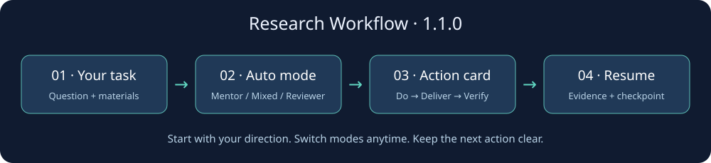

# Research Workflow

[简体中文](README.md) · [English](README.en.md) · [快速上手](docs/quickstart.md) · [更新记录](CHANGELOG.md)


**科研导师与审稿插件：直接说任务，自动选择模式，用清晰行动和真实证据推进研究。**



## 三分钟开始

Claude Code：

```text
/plugin marketplace add HaoYangJin/Research-workflow-Skill
/plugin install research-workflow@research-workflow-marketplace
```

然后输入：

```text
/research-workflow:research-mentor
我想研究时间序列漂移。请用合成数据和 Python 标准库做一个低成本实验，先给我三步行动。
```

Codex CLI（0.163.0 安装链路曾核验；本版尚未做账户端到端验证）：

```bash
codex plugin marketplace add HaoYangJin/Research-workflow-Skill --ref v1.1.0
codex plugin add research-workflow@research-workflow-marketplace
```

新会话中用 `$research-mentor` 加上你的任务即可。桌面与云端导入见 [安装指南](docs/openai-install.md)，其他方式见 [USAGE](USAGE.md)。

## 三档模式，不用记命令

| ① 导师 mentor | ② 混合 mixed | ③ 审稿 reviewer |
| --- | --- | --- |
| 选题、学习、设计下一步 | 推进方案并检查关键问题 | 检查已有材料的明显方法错误 |
| 目标 → 操作 → 验收 | 两个短视角＋共享行动 | 证据位置 → 修复 → 验证 |

默认按当前任务、项目偏好和阶段判断。随时说“导师模式 / 混合模式 / 审稿模式 / 自动”。支持选择控件的平台可展示三选一；其余平台显示文本选择条，并直接开始工作。项目保存偏好与切换历史；没有持久存储时仅保留当前对话上下文。

**指导原则**：优先沿你的可行方向尝试；不凑缺陷数量，不把材料缺失当成错误。只有明确原理/方法错误或不可执行时才阻断，并给出修复路径。要求“严格审查并复现”后，才扩大到全流程核查，按需请求数据和代码。

## 你会得到什么

| 任务 | 主要交付 |
| --- | --- |
| 选题与文献 | 有边界的问题、来源与文献图谱 |
| 假设与实验 | 可证伪假设、对照、指标和预算 |
| 数据与结果 | 复现命令、实际输出、消融与不确定性 |
| 写作与修改 | 证据关联草稿、问题修复表、回应稿 |
| 投稿判断 | ready / not_ready、剩余问题和下一步 |

小问题直接回答；持续项目才创建检查点。回答默认是简短任务卡，需要时补表格或流程图。[可复制对话与教程](docs/quickstart.md) · [详细示例](docs/conversation-examples.md)。

## v1.1.0 修复

- 操作系统锁自动随进程释放，修复异常退出后无法写入。
- 新增模式切换命令、历史记录与自动阶段选择。
- v1.0.0 项目可显式迁移，先验证并保存备份。
- 删除根目录重复技能入口；发布 ZIP 带使用指南。

[发布说明与缺陷对应](docs/RELEASE-v1.1.0.md) · [验证与未覆盖范围](docs/validation-v1.1.0.md) · [v1.0.0 原缺陷报告](docs/limitations-v1.0.0.md)。

## 为什么保留 Skill 和仓库名

插件是分发方式，`skills/research-mentor/` 是唯一技能源码，两者配合使用。保留仓库地址和 `research-workflow` 插件标识，避免打断旧安装；界面名称统一为 Research Workflow。独立 Skill 仍可安装，但不要与插件重复启用。[结构参考与整理依据](docs/repository-design.md)。

```text
.claude-plugin/          Claude 插件与 marketplace
.codex-plugin/           Codex 插件
skills/research-mentor/  唯一技能入口、阶段参考、本地 CLI
scripts/                安装、验证、可重复打包
tests/                  工作流与发布回归测试
examples/drift-study/   可重跑的合成研究
docs/                   教程、版本说明和验证记录
assets/                 图标和使用流程图
```

## 本地试用与升级

Python 3.10+；标准库，无需付费 API。

```bash
python examples/drift-study/experiment.py --out /tmp/drift-demo
python skills/research-mentor/scripts/workflow.py init /tmp/my-study --title "我的问题"
python skills/research-mentor/scripts/workflow.py mode /tmp/my-study --select reviewer
# 仅升级已有 v1.0.0 项目时执行：
python skills/research-mentor/scripts/workflow.py migrate /path/to/old-study
```

CLI 负责记录和结构校验；论文检索、实验与研究判断由 AI 客户端及可用工具完成。它不能认证科学正确性或保证录用。单机本地锁已验证，共享文件系统和跨机器写入不在支持范围内。

```bash
python -m unittest discover -s tests -v
python scripts/validate_repo.py
python scripts/build_release.py --output dist
```

## Star History

[](https://www.star-history.com/#HaoYangJin/Research-workflow-Skill&Date)

图表由 Star History 在线生成，可能因第三方可用性或 GitHub API 限额暂时无法加载。

## 贡献与许可

[贡献指南](CONTRIBUTING.md) · [MIT](LICENSE) · [历史版本](https://github.com/HaoYangJin/Research-workflow-Skill/releases)
